# Codyssey Mission 2 — Python 기초 퀴즈 게임

## 프로젝트 개요

Python 기본 문법, 클래스, JSON 파일 입출력과 Git을 학습하기 위해 만든 콘솔 퀴즈 게임이다. 터미널에서 번호를 선택해 퀴즈를 풀거나 추가하고, 목록과 최고 점수를 확인한다. 추가한 문제와 최고 기록은 재실행 후에도 유지된다.

완성된 기능뿐 아니라 **메뉴부터 기능을 하나씩 구현하고, 확인하고, 커밋한 과정**을 미션 요구사항 순서대로 기록했다. 필수 기능을 완성한 뒤 별도 브랜치에서 보너스 5가지도 구현했다. 1~13단계와 기존 이미지는 필수 기능 개발 당시의 기록으로 보존하고, 이후 변경은 아래 **보너스 과제 개발 과정**에 구분해 기록했다.

## 퀴즈 주제와 선정 이유

주제는 **Python 기초 문법**이다. 미션에서 배우는 자료형, 조건문, 함수, 불리언, 리스트 인덱스를 문제로 구성해 개발과 학습 내용을 연결했다. 기본 문제는 5개이며, 각 문제는 선택지 4개와 1~4의 정답 번호를 갖는다.

## 개발 환경

| 항목 | 환경 |
| --- | --- |
| 운영체제 | Windows |
| 편집기 | Visual Studio Code |
| Python | 3.14.5 — 미션 기준은 3.10 이상 |
| Git | 2.51.2.windows.1 |
| 라이브러리 | 표준 라이브러리 `json`, `pathlib`, `random`, `datetime` |

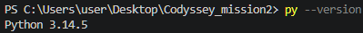
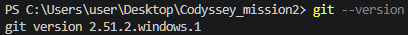
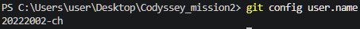

## 개발 과정

### 1. 개발 환경 및 저장소 초기 설정

**목표와 진행:** 미션 1과 구분되는 `Codyssey_mission2` 저장소와 작업 폴더를 준비했다. `.gitignore`, `README.md`, `main.py`를 만들고 환영 문구 한 줄을 실행하는 것부터 시작했다. 초기 구성: [`b0348cf`](https://github.com/20222002-ch/Codyssey_mission2/commit/b0348cf).

**겪은 문제와 해결:** VS Code에서 이전 미션 폴더가 열려 있어 예전 저장소가 연결된 것처럼 보였다. 기존 원격 주소를 바꾸는 대신 미션 2 폴더를 따로 열고 `git remote -v`로 대상을 확인하는 방식으로 구분했다. `python --version`에서는 숫자 없이 `Python`만 출력되었다. 이후 `py --version`으로 Python 3.14.5를 확인했고 실행도 `py main.py`를 사용했다. 당시 현상만으로 별칭과 PATH 중 어느 것이 원인인지는 단정하지 않았다.

**정리한 개념:** VS Code에서 연 폴더, 로컬 저장소, GitHub 원격 저장소는 각각 확인해야 한다. `.gitignore`에는 캐시와 가상환경 등을 지정했다.

### 2. 메뉴 및 입력 처리 구현

**진행:** `show_menu()`, `read_menu_choice()`, `main()`으로 출력·입력·진행을 나눴다. `while`로 반복하고 `if/elif`로 분기했다. `strip()`으로 공백을 제거하고 정수로 변환하며 빈 입력·문자·범위 밖 번호는 다시 받는다. 커밋: [`ad3ca07`](https://github.com/20222002-ch/Codyssey_mission2/commit/ad3ca07).

**선택 이유와 확인:** 잘못된 입력 때문에 프로그램이 끝나지 않도록 `ValueError`를 처리했다. 개발 중 캡처에서 문자, 0, 빈 입력의 재입력과 `Ctrl+C` 종료 안내를 확인할 수 있다. 최종 검증에서도 재확인했다.

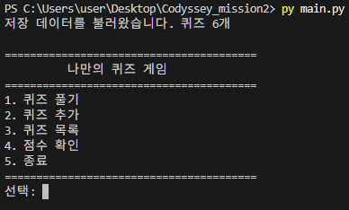
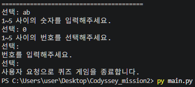

### 3. Quiz 클래스 작성

**진행:** 개별 문제의 `question`, `choices`, `answer`를 객체에 담았다. `display()`는 문제와 선택지를 출력하고 `check_answer()`는 정답 여부를 반환한다. 커밋: [`7aa7665`](https://github.com/20222002-ch/Codyssey_mission2/commit/7aa7665).

**선택 이유와 확인:** 관련 데이터와 동작을 한 객체로 묶었다. `__init__`은 초기화, `self`는 현재 객체의 속성과 메서드 접근에 사용한다. 정답 입력은 `True`, 오답은 `False`를 반환하는 것을 검증했다.

### 4. 기본 퀴즈 데이터 작성

**진행:** `create_default_quizzes()`에서 기본 문제 5개를 `Quiz` 객체로 만들어 리스트로 반환했다. 선택지 4개와 1~4의 정수 정답 번호를 사용했다. 커밋: [`300b886`](https://github.com/20222002-ch/Codyssey_mission2/commit/300b886).

**선택 이유와 확인:** 생성 함수를 분리해 첫 실행과 파일 복구에 재사용했다. 문제 수·선택지 수·정답 범위를 검증했다. 리스트 인덱스는 0부터 시작하지만 사용자에게 보여주는 번호는 1부터 시작한다는 기준을 유지했다.

### 5. 별도 브랜치에서 퀴즈 풀기 구현 및 병합

**진행:** `git checkout -b codex/quiz-play`로 브랜치를 만들었다. `play_quizzes()`에서 순서대로 출제하고 `read_answer()`로 답을 받았다. 정답·오답을 안내하고 완료 시 정답 수와 점수를 출력했다. 빈 목록은 안내 후 반환한다. 기능: [`12072df`](https://github.com/20222002-ch/Codyssey_mission2/commit/12072df), 병합: [`339a69e`](https://github.com/20222002-ch/Codyssey_mission2/commit/339a69e).

**선택 이유와 확인:** `Quiz`의 출력·판별 메서드를 재사용하고 전체 진행은 함수로 분리했다. 빈 목록을 먼저 처리해 0으로 나누는 계산을 방지했다. `--no-ff`로 병합 기록을 남겨 아래 그래프에서 갈라졌다 합쳐지는 흐름을 확인했다.

프로젝트 루트에서 다음 명령으로 아래 풀이 결과 로그 창을 연다.

```powershell
py docs/verification/view_log.py docs/verification/play.txt
```

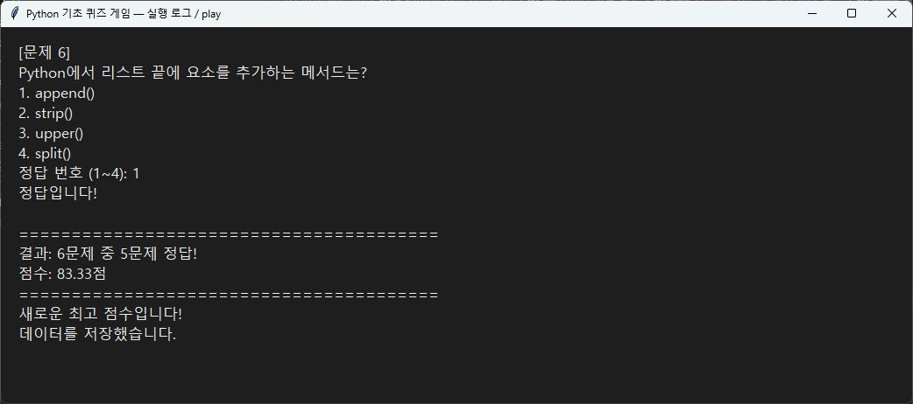

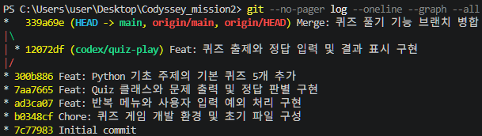

### 6. 퀴즈 추가 기능 구현

**진행:** 문제, 선택지 4개, 정답 번호를 받아 새 객체를 추가했다. `read_non_empty_text()`로 빈 문장을 막고 기존 `read_answer()`로 정답 범위를 검증했다. 커밋: [`91484e3`](https://github.com/20222002-ch/Codyssey_mission2/commit/91484e3).

**선택 이유와 확인:** 모든 입력이 끝나야 등록해 입력 도중 취소된 문제가 남지 않도록 했다. 처음에는 실행 중 리스트에만 추가했고 10단계에서 저장을 연결했다. 최종 검증에서 빈 문제·선택지와 잘못된 정답 번호를 재입력한 뒤 6번째 문제가 등록되는 것을 확인했다.

프로젝트 루트에서 다음 명령으로 아래 등록 로그 창을 연다.

```powershell
py docs/verification/view_log.py docs/verification/add.txt
```

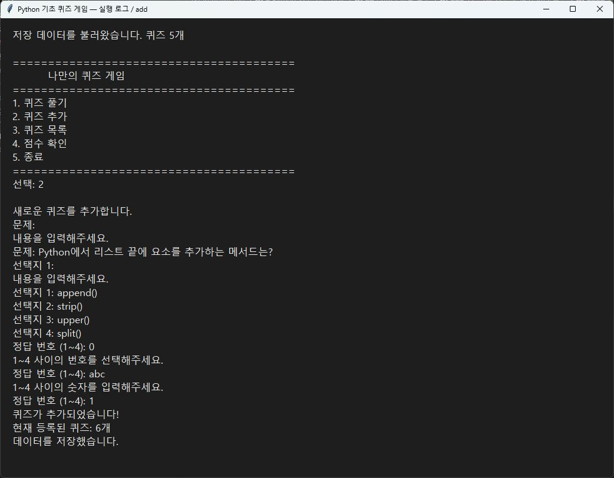

### 7. 퀴즈 목록 기능 구현

**진행:** `show_quiz_list()`로 전체 문제 수와 번호별 문제 문장을 출력했다. 빈 목록에는 안내를 추가했다. 커밋: [`f3ac6b7`](https://github.com/20222002-ch/Codyssey_mission2/commit/f3ac6b7).

**선택 이유와 확인:** 추가와 조회가 같은 리스트를 사용하도록 했다. 개발 중 저장한 화면에서 5개였던 목록이 등록 후 6개가 된 것을 확인할 수 있다.

추가 전:

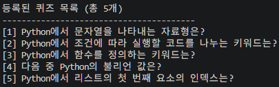

추가 후:

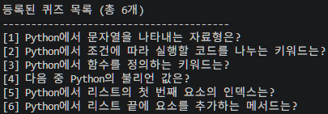

### 8. 최고 점수 기능 구현

**진행:** 결과를 `score`, `correct_count`, `total` 딕셔너리로 반환하고 높은 점수일 때만 최고 기록을 갱신했다. 메뉴 4번에 조회를 연결했다. 커밋: [`fc29e72`](https://github.com/20222002-ch/Codyssey_mission2/commit/fc29e72).

**설계상 고려와 해결:** 미플레이를 0으로 표현하면 실제 0점 기록과 구분하기 어렵다. 미플레이는 `None`, 완료한 게임은 0점이어도 딕셔너리로 관리했다. 문제 수가 달라도 비교할 수 있도록 100점으로 환산하고 소수점 둘째 자리까지 반올림한다. 동점은 기존 기록을 유지한다.

**확인:** 미플레이 안내, 0점 등록, 높은 점수 갱신, 낮거나 같은 점수에서 유지되는 동작을 검증했다. 이 단계의 메모리상 기록은 10단계에서 파일 저장과 연결했다.

프로젝트 루트에서 다음 명령으로 아래 최고 점수 로그 창을 연다.

```powershell
py docs/verification/view_log.py docs/verification/score.txt
```

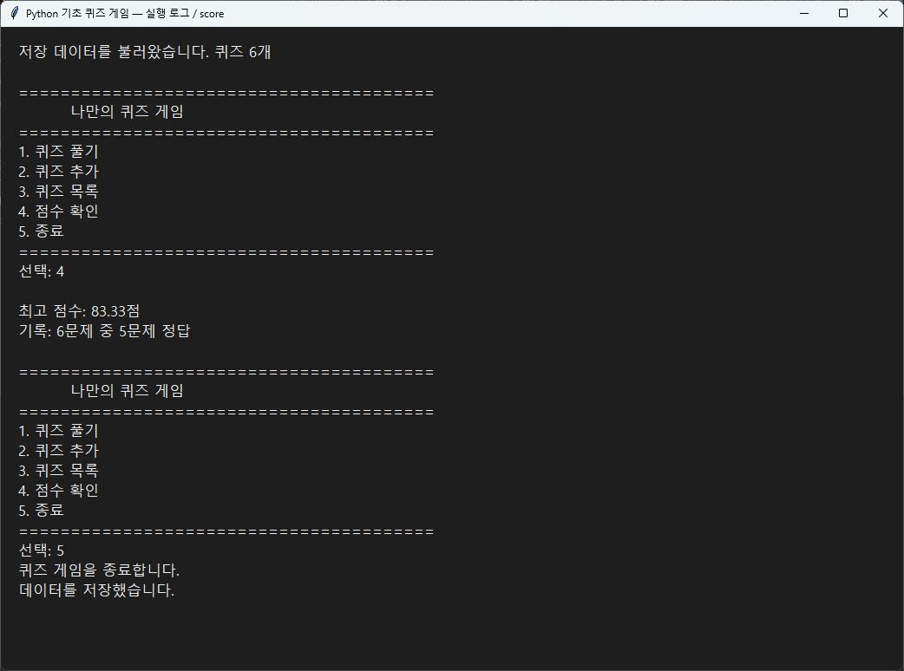

### 9. QuizGame 클래스로 구조 정리

**진행:** 기존 `main()`의 목록과 최고 기록을 `QuizGame` 속성으로 옮겼다. `run()`은 메뉴 반복, `play()`는 게임 진행과 기록 갱신을 맡는다. 등록·목록·점수 조회는 기존 함수와 연결했다. 커밋: [`b104406`](https://github.com/20222002-ch/Codyssey_mission2/commit/b104406).

**선택 이유와 확인:** `Quiz`는 개별 문제, `QuizGame`은 전체 상태를 담당한다. 세부 함수는 재사용하고 `main()`은 객체 생성과 실행 중심으로 줄였다. 구조 변경 후 등록·조회·풀이·점수 흐름을 최종 검증했다.

### 10. state.json 저장 및 불러오기 구현

**진행:** `save_state()`, `load_state()`, `parse_state()`를 추가했다. 객체를 딕셔너리로 변환해 UTF-8 JSON으로 저장하고 불러올 때 검증 후 복원한다. 등록 직후, 게임 완료 후, 종료 시 저장한다. 커밋: [`d56f49d`](https://github.com/20222002-ch/Codyssey_mission2/commit/d56f49d).

**진행 중 확인한 점:** `state.json`의 위치가 혼동되었다. 경로는 `Path(__file__).resolve().parent / "state.json"`이므로 터미널 위치가 아니라 `main.py` 옆이다. 저장이 실행되면 파일이 생성된다.

**설계상 고려와 해결:** 누락·손상 파일은 기본 데이터로 시작하고, 검증을 모두 통과해야 불러온 상태를 적용한다. 저장은 `state.tmp`에 먼저 쓰고 교체한다. 읽기·쓰기 오류는 안내하고 종료 시 `finally`에서 저장을 시도한다. 손상 파일로 시작한 후 저장하면 기본 데이터로 덮어쓰므로 중요한 기록은 백업해야 한다.

**확인:** 검증 폴더에서 6번째 문제와 83.33점 기록을 저장한 뒤 재실행해 복원했다. 파일 누락·손상·저장 실패 및 원인 제거 후 재저장도 확인했다.

프로젝트 루트에서 다음 명령으로 아래 재실행 로그 창을 연다.

```powershell
py docs/verification/view_log.py docs/verification/reload.txt
```

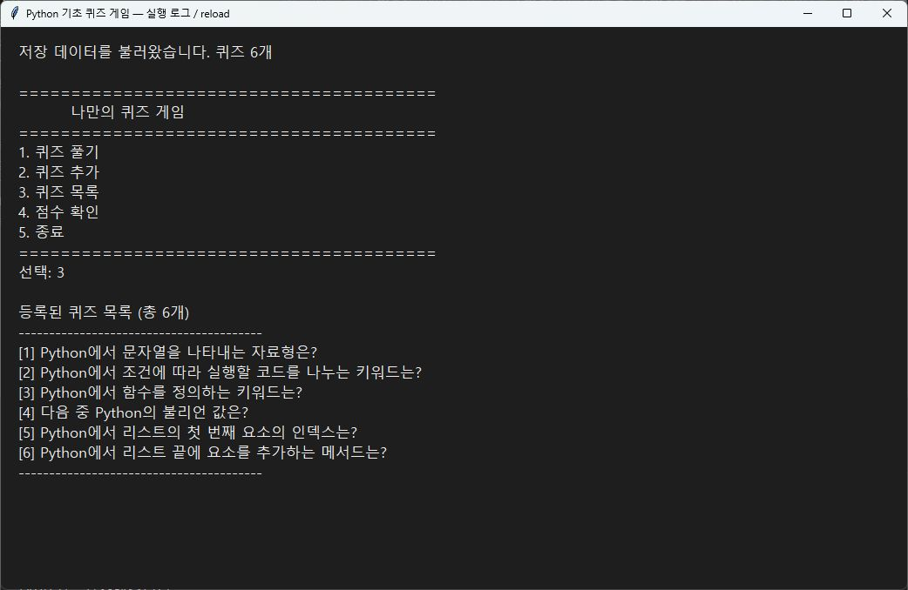

### 11. 전체 기능 및 예외 처리 검증

필수 기능 완성 당시 기존 개발 화면을 확인하고, 동일 `main.py`를 임시 폴더에 복사해 검증했다. 입력과 `KeyboardInterrupt`·`EOFError`는 검증 코드에서 주입했다. 당시 **31개 확인 항목이 통과**했으며 결과는 [`results-required-v1.json`](docs/verification/results-required-v1.json)에 보존했다. 이후 보너스 구현에 맞춰 검증 코드를 확장했다. 현재 검증 결과는 아래 보너스 절과 `results.json`을 기준으로 한다.

| 검증 항목 | 결과 |
| --- | --- |
| 기본 문제·선택지·정답 범위, 정답·오답 판별 | 통과 |
| 메뉴·정답의 빈 입력, 공백, 문자, 범위 밖 숫자 처리 | 통과 |
| 빈 문제·선택지 재입력과 등록 | 통과 |
| 추가한 문제의 조회·출제와 점수 계산 | 통과 |
| 미플레이와 0점 구분, 최고 기록 갱신·유지 | 통과 |
| 재실행 후 퀴즈·최고 기록 복원 | 통과 |
| 메뉴·풀이·등록 중 중단·EOF, 미완성 데이터 제외 | 통과 |
| 파일 누락, JSON 문법·구조·점수 오류 복구 | 통과 |
| 쓰기 오류 안내 및 원인 제거 후 재저장 | 통과 |
| 빈 목록 처리와 스크립트 기준 저장 경로 | 통과 |

현재 검증 실행기: [`verify.py`](docs/verification/verify.py), 테스트: [`test_bonus.py`](docs/verification/test_bonus.py), 세부 결과: [`results.json`](docs/verification/results.json). 다음 명령으로 임시 폴더에서 재검증할 수 있다. 원래 게임 데이터는 변경하지 않는다.

```powershell
py docs/verification/verify.py
```

실제 터미널에서 입력 스트림 종료를 확인한 화면:

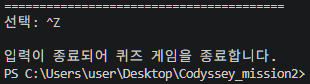

### 12. README와 실행 증거 정리

초기 문서에 남은 작성 안내 문구, 중복 제목, 이스케이프된 Markdown을 정리했다. 실제로 겪은 문제와 설계 시 고려한 문제를 구분하고 필수 설명·실행 증거를 보완했다.

바탕화면의 기존 스크린샷은 원본을 보존하고 `docs/screenshots`로 복사했다. 메뉴·환경·목록 전후·입력 오류·종료·Git 기록은 기존 화면을 사용했다. 부족한 등록·풀이·점수·재실행 이미지는 **실제 검증 실행 로그를 읽기 전용 창에 표시해 촬영**했다. 이 보완 화면은 새 GUI 게임이 아니다. 검증 입력값을 로그에 함께 표시했고 풀이 이미지는 마지막 문제와 결과를 발췌했다. 선택 강조와 마우스 포인터가 보이지 않도록 촬영했다.

로그 텍스트: [등록](docs/verification/add.txt), [풀이](docs/verification/play.txt), [점수](docs/verification/score.txt), [재실행](docs/verification/reload.txt).

#### 어떤 파일을 실행하고 촬영했는가

| 파일 | 역할 |
| --- | --- |
| [`main.py`](main.py) | 실제 콘솔 게임. 직접 입력하며 플레이할 때 실행 |
| [`verify.py`](docs/verification/verify.py) | 현재 게임 코드를 임시 폴더에서 검증하고 `bonus-*.txt` 실행 로그를 생성 |
| [`view_log.py`](docs/verification/view_log.py) | 저장된 UTF-8 로그를 `tkinter` 읽기 전용 창으로 표시 |
| `add.txt` | 퀴즈 등록과 잘못된 입력 재입력 로그 |
| `play.txt` | 마지막 문제 풀이와 최종 결과 발췌 |
| `score.txt` | 다시 실행한 뒤 최고 점수를 조회한 로그 |
| `reload.txt` | 다시 실행한 뒤 목록과 점수를 확인한 로그 |
| `results.json` | 검증 항목별 통과 여부 |

보완 촬영에는 `main.py`의 실제 실행 결과를 저장한 위 텍스트 파일을 사용했다. `view_log.py`는 `Path.read_text()`로 파일을 읽고, `tkinter`의 `Text` 위젯에 표시한 뒤 `state="disabled"`로 편집을 막고 `mainloop()`로 창을 유지한다. 화면의 선택 강조 없이 촬영했다. 저장소에 포함한 뷰어에는 긴 로그를 끝까지 볼 수 있도록 가로·세로 스크롤바도 추가했다.

#### 로그 창 여는 방법

1. VS Code에서 **`Codyssey_mission2` 프로젝트 폴더**를 연다.
2. **터미널 → 새 터미널**을 선택한다. 아래 명령은 `main.py`와 `README.md`가 있는 프로젝트 루트에서 실행한다.
3. 보고 싶은 로그에 해당하는 명령 하나를 실행한다.

```powershell
# 퀴즈 등록 로그
py docs/verification/view_log.py docs/verification/add.txt

# 마지막 문제와 풀이 결과
py docs/verification/view_log.py docs/verification/play.txt

# 최고 점수 조회
py docs/verification/view_log.py docs/verification/score.txt

# 재실행 후 저장 데이터 확인
py docs/verification/view_log.py docs/verification/reload.txt
```

창이 열리면 스크롤로 내용을 확인하고 오른쪽 위 닫기 버튼으로 종료한다. 환경에 따라 맨 앞의 `py`를 `python` 또는 `python3`로 바꾼다. `tkinter`가 포함된 Python과 그래픽 화면을 사용할 수 있는 환경이 필요하며, 표준 Windows Python 환경에서는 별도 pip 패키지가 필요 없다. `No module named tkinter` 오류가 나오면 Python 설치 구성에서 Tcl/Tk 지원을 확인한다.

위 명령은 **기존 로그를 보여줄 뿐 게임을 새로 실행하거나 점수를 변경하지 않는다.** 실제로 직접 게임을 하려면 `py main.py`를 실행한다.

#### 로그를 새로 생성하는 방법

같은 프로젝트 루트에서 검증 코드를 먼저 실행한다.

```powershell
py docs/verification/verify.py
```

검증은 게임 코드를 임시 폴더에 복사해 수행하며 원본 `state.json`은 유지한다. 현재 실행기는 `docs/verification`의 `bonus-play.txt`, `bonus-history.txt`, `bonus-add.txt`, `bonus-delete.txt`, `bonus-reload.txt`와 `results.json`을 새 결과로 덮어쓴다. 기존 네 로그(`add.txt` 등)는 필수 기능 당시 기록으로 보존한다. 새 로그는 아래 보너스 절의 명령으로 연다. 텍스트를 재생성해도 스크린샷은 자동 갱신되지 않으므로 새 결과는 다시 촬영해야 한다.

### 13. 저장소 clone 및 pull 실습

**진행:** 별도 `Codyssey_mission2_clone` 폴더에 복제하고 README를 수정해 커밋·푸시했다. 기존 폴더에서 원격 변경을 가져와 반영을 확인했다.

```powershell
# 기존 프로젝트의 상위 폴더에서
git clone https://github.com/20222002-ch/Codyssey_mission2.git Codyssey_mission2_clone
cd Codyssey_mission2_clone
# README 수정 후
git add README.md
git commit -m "Docs: 복제한 저장소에서 Git 동기화 실습 기록 추가"
git push origin main

# 기존 폴더에서 원격 변경 반영
cd ..\Codyssey_mission2
git pull --ff-only origin main
```

**확인:** 복제 폴더 reflog에 clone 기록과 README 수정 커밋 [`5d14ece`](https://github.com/20222002-ch/Codyssey_mission2/commit/5d14ece)가 있다. 기존 폴더 reflog에는 해당 커밋을 가져온 `pull --ff-only origin main: Fast-forward`가 있다. 이후 실습 결과를 [`b0c911c`](https://github.com/20222002-ch/Codyssey_mission2/commit/b0c911c)에 기록했다.

**정리한 개념:** `clone`은 새 폴더에 저장소를 복제하고 `pull`은 기존 저장소에 원격 변경을 반영한다. 두 폴더 사이에 파일을 직접 복사하지 않아도 같은 커밋을 공유할 수 있다.

### Git 조회 화면에서 겪은 문제

`git diff` 후 명령 입력으로 돌아오지 못했다. 내용이 길 때 열리는 pager의 `(END)` 화면이었고 영문 `q`로 종료했다. 이후 로그를 한 번에 확인할 때는 `git --no-pager log --oneline --graph --all`을 사용했다.

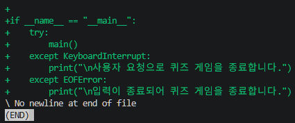

## Git 변경 이력

문서 최종 정리 직전 총 15개 커밋이며 병합을 제외하면 14개다. 메뉴, 클래스, 기본 데이터, 출제, 등록, 목록, 점수, 구조 정리, 파일 입출력 등을 기능별로 커밋했다. 아래 이미지는 `b0c911c`까지의 개발 기록이며 이후 문서 정리 커밋은 포함하지 않는다.

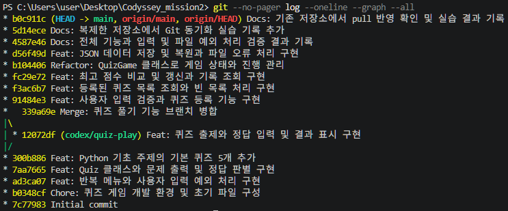

| 명령 | 역할 |
| --- | --- |
| `init` | 로컬 저장소 초기화 |
| `add` | 다음 커밋에 포함할 변경 선택 |
| `commit` | 변경 이력 기록 |
| `push` | 로컬 커밋을 GitHub로 전송 |
| `checkout` | 브랜치 생성·이동 |
| `merge` | 작업 브랜치 병합 |
| `clone` | 새 폴더에 원격 저장소 복제 |
| `pull` | 기존 저장소에 원격 변경 반영 |

## 실행 방법

Python 3.10 이상이 필요하다. 별도 패키지 설치는 필요 없다.

```powershell
git clone https://github.com/20222002-ch/Codyssey_mission2.git
cd Codyssey_mission2
py main.py
```

환경에 따라 `python main.py` 또는 `python3 main.py`를 사용한다. 번호로 메뉴를 선택하고 5번으로 종료한다. `state.json`이 있으면 저장 데이터를, 없으면 기본 5문제를 사용한다. 기존 저장 파일은 삭제할 필요가 없다.

퀴즈 풀기를 선택하면 풀 문제 수를 입력한다. `0`은 시작 취소이며, 출제 중 `h`로 힌트를 볼 수 있다. 6번은 삭제, 7번은 게임 기록 조회다.

## 기능 목록

| 메뉴 | 기능 |
| --- | --- |
| 1. 퀴즈 풀기 | 문제 수 선택 후 중복 없이 랜덤 출제, 힌트 및 결과 안내 |
| 2. 퀴즈 추가 | 문제·선택지 4개·정답 번호·선택적 힌트 입력 후 저장 |
| 3. 퀴즈 목록 | 등록된 문제 수와 제목 조회 |
| 4. 점수 확인 | 최고 점수와 당시 정답 수·문제 수 조회 |
| 5. 종료 | 현재 데이터 저장 시도 후 종료 |
| 6. 퀴즈 삭제 | 문제 선택과 y/n 확인 후 삭제·저장, 0으로 취소 |
| 7. 점수 히스토리 | 모든 완료 게임의 날짜·시간·문제 수·정답 수·점수·힌트 사용을 최신순 조회 |

잘못된 입력, 빈 목록, 파일 누락·손상, 읽기·쓰기 오류와 입력 중단을 처리한다. 랜덤 출제·문제 수 선택·힌트·삭제·점수 히스토리 보너스 5가지를 모두 제공한다.

## 파일 구조

```text
Codyssey_mission2/
├── docs/
│   ├── screenshots/       # 개발 화면과 보완 실행 로그 이미지
│   └── verification/
│       ├── verify.py      # 임시 폴더에서 게임 검증 및 로그 생성
│       ├── test_bonus.py  # 기존 기능 및 보너스 회귀 테스트
│       ├── view_log.py    # 저장된 로그를 읽기 전용 창으로 표시
│       ├── results.json   # 검증 항목별 결과
│       ├── results-required-v1.json # 필수 기능 당시 31개 검증 결과
│       ├── bonus-*.txt    # 현재 보너스 기능 실행 로그 5개
│       ├── add.txt        # 등록 로그
│       ├── play.txt       # 마지막 문제와 결과 발췌
│       ├── score.txt      # 최고 점수 조회 로그
│       └── reload.txt     # 재실행 후 조회 로그
├── .gitignore
├── README.md
├── main.py                # Quiz, QuizGame, 입력·출력 및 실행 함수
└── state.json             # 퀴즈와 최고 기록
```

`state.tmp`는 저장 시 사용하는 임시 파일이다. 캐시, 가상환경, 임시 파일과 `state.backup.json`은 Git 관리에서 제외한다.

## 데이터 파일 설명

- **경로:** `main.py`와 같은 프로젝트 루트의 `state.json`
- **인코딩:** UTF-8. `ensure_ascii=False`로 한글을 읽을 수 있게 저장
- **저장:** 등록 후, 게임 완료 후, 정상 종료 또는 입력 중단 시 저장 시도
- **불러오기:** 시작 시 JSON과 필드 구조를 검사한 뒤 상태에 반영

| 필드 | 내용 |
| --- | --- |
| `quizzes` | 퀴즈 목록. 빈 목록도 허용 |
| `question` | 비어 있지 않은 문제 문자열 |
| `choices` | 비어 있지 않은 선택지 문자열 4개 |
| `answer` | 1~4의 정수 정답 번호 |
| `best_score` | 미플레이는 `null`, 완료 기록은 아래 객체 |
| `hint` | 선택적 힌트 문자열. 빈 문자열이면 힌트 없음 |
| `score` | 정답 비율 × 100 - 힌트 사용 문제 수 × 10, 최소 0점, 소수점 둘째 자리 반올림 |
| `correct_count` | 최고 기록의 정답 수 |
| `total` | 최고 기록의 전체 문제 수 |
| `hints_used` | 해당 게임에서 힌트를 사용한 문제 수 |
| `history` | 완료한 모든 게임 기록의 목록 |
| `played_at` | 히스토리의 실행 컴퓨터 현지 시각. 시간대가 포함된 ISO 8601 문자열 |

필드 구조 예시이며 실제 파일에는 전체 문제가 들어간다.

```json
{
  "quizzes": [
    {
      "question": "Python에서 문자열을 나타내는 자료형은?",
      "choices": ["int", "str", "bool", "list"],
      "answer": 2,
      "hint": "string의 약자입니다."
    }
  ],
  "best_score": {"score": 90.0, "correct_count": 1, "total": 1, "hints_used": 1},
  "history": [
    {"score": 90.0, "correct_count": 1, "total": 1, "hints_used": 1, "played_at": "2026-11-08T20:00:00+09:00"}
  ]
}
```

파일이 없거나 손상되면 기본 5문제와 미플레이 상태로 시작한다. 저장 실패 시 안내하고 실행 중 데이터는 메모리에 유지한다. 등록 도중 취소한 문제와 미완료 게임 결과는 기록에 반영하지 않는다.

**기존 파일 호환:** `history`가 없으면 빈 목록, 기록에 `hints_used`가 없으면 0으로 읽는다. 퀴즈의 `hint`가 누락되면 기본 문제는 문제 문장이 일치하는 기본 힌트로 보완하고 사용자 문제는 힌트 없이 읽는다. 사용자가 명시적으로 저장한 빈 힌트는 유지한다. 예전 최고 점수는 보존하며 날짜를 알 수 없는 예전 기록을 히스토리로 만들어 넣지는 않는다. 실제 저장은 다음 등록·완료·종료 시 새 구조로 이루어진다.

## 보너스 과제 개발 과정

필수 개발 기록을 유지하기 위해 `codex/bonus-features` 브랜치에서 기능별로 작업했다. 원래 `state.json`을 덮어쓰지 않고 임시 폴더에서 기존 형식과 새 형식을 모두 검증했다.

### B1. 랜덤 출제와 문제 수 선택

**구현:** 퀴즈가 있으면 1~전체 문제 수를 선택하고 `random.sample(quizzes, total)`로 중복 없이 뽑는다. 0은 취소다. 빈 입력·문자·음수·범위 초과를 재입력하게 했다. 기능 커밋: [`55ecf60`](https://github.com/20222002-ch/Codyssey_mission2/commit/55ecf60).

**고려와 해결:** 원본 목록을 직접 섞으면 목록 순서와 삭제 번호도 달라진다. 별도 표본 리스트를 사용해 원본은 유지했다. 무작위 기능을 검증할 때는 특정 출제 순서를 지정한 테스트와 실제 `random.sample`의 중복 없는 표본 테스트를 나눴다. 실행 로그 생성에만 seed 17을 사용하며 실제 게임은 seed를 고정하지 않는다.

### B2. 힌트와 감점

**구현:** `Quiz.hint`를 추가하고 등록 시 Enter로 생략할 수 있게 했다. 풀이 중 `h` 또는 `H`로 조회한다. 힌트를 사용한 문제마다 최종 점수에서 10점을 차감하고 0점 미만으로 내려가지 않는다. 같은 문제에서 반복 조회해도 한 번만 차감하며, 힌트가 없는 문제는 차감하지 않는다. 기능 커밋: [`14d89ae`](https://github.com/20222002-ch/Codyssey_mission2/commit/14d89ae).

**고려와 해결:** 기존 최고 기록 검증은 정답 비율만 계산했기 때문에 감점된 기록을 손상 데이터로 처리할 수 있었다. 저장·불러오기와 점수 계산이 같은 `calculate_score()`를 사용하도록 바꾸고 `hints_used`를 함께 저장했다. 예전 기록은 힌트 0회로 해석한다.

**확인:** 3문제 전부 정답에 힌트 1회면 90점, 같은 힌트를 두 번 확인해도 90점이다. 오답과 힌트 감점이 겹쳐도 최소 0점이다. 아래 화면은 문제 수 입력 검증과 첫 문제의 반복 힌트 확인 부분이다. 스크롤하면 최종 90점 결과까지 볼 수 있다.

```powershell
py docs/verification/view_log.py docs/verification/bonus-play.txt
```

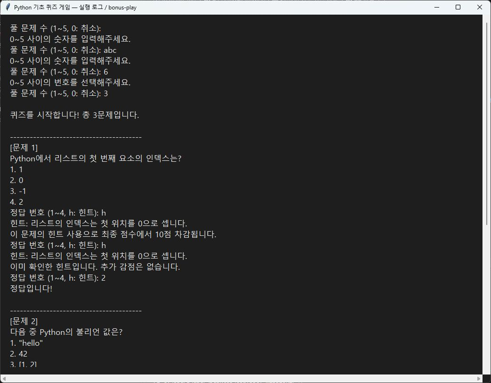

### B3. 퀴즈 삭제

**구현:** 메뉴 6번에서 목록과 문제 번호를 보여주고 `y/n`으로 다시 확인한다. 0 또는 n은 취소하며 y일 때만 삭제하고 저장한다. 마지막 문제를 삭제한 빈 목록도 다시 실행했을 때 유지한다. 기능 커밋: [`73c2efe`](https://github.com/20222002-ch/Codyssey_mission2/commit/73c2efe).

**고려와 해결:** 메모리에서만 지워진 뒤 저장에 실패하면 재실행 결과가 달라진다. 저장 실패 시 같은 객체를 원래 인덱스에 다시 넣고 삭제 취소를 안내하도록 했다. 이미 완료한 점수와 히스토리는 과거 기록이므로 문제 삭제 후에도 보존한다.

```powershell
py docs/verification/view_log.py docs/verification/bonus-delete.txt
```

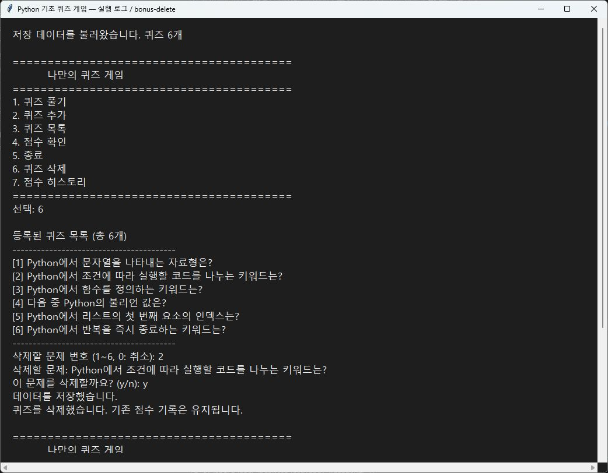

### B4. 점수 히스토리

**구현:** 게임을 끝까지 완료할 때마다 `history`에 결과와 `datetime.now().astimezone().isoformat()` 날짜를 추가한다. 메뉴 7번은 최신순으로 날짜·시간대, 문제 수, 정답 수, 점수, 힌트 횟수를 표시한다. 새 최고 점수가 아닌 게임도 남긴다. 기능 커밋: [`73c2efe`](https://github.com/20222002-ch/Codyssey_mission2/commit/73c2efe).

**고려와 해결:** 취소하거나 중단한 게임을 기록하지 않도록 결과를 받은 뒤에만 추가한다. 과거 기록의 문제 수를 현재 목록 개수와 비교하지 않아 문제 삭제 후에도 유효하게 불러온다. 시간대 없는 날짜나 잘못된 점수·힌트 횟수는 검증에서 거른다.

```powershell
py docs/verification/view_log.py docs/verification/bonus-history.txt
```

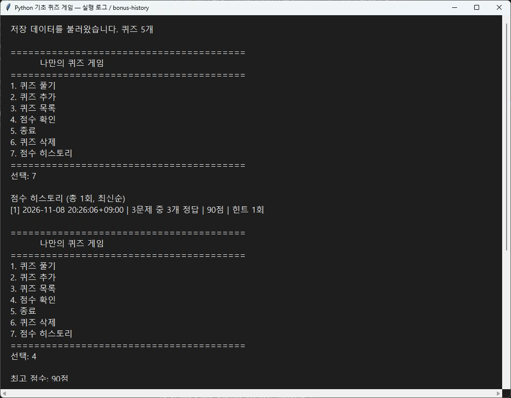

힌트 포함 문제 등록과 삭제 후 재실행도 로그로 확인할 수 있다.

```powershell
py docs/verification/view_log.py docs/verification/bonus-add.txt
py docs/verification/view_log.py docs/verification/bonus-reload.txt
```

### B5. 회귀 검증과 재현

[`test_bonus.py`](docs/verification/test_bonus.py)의 **40개 테스트가 통과**했다. `results.json`에는 40개 테스트 결과와 원본 데이터 보존 확인 1개를 별도로 기록한다. 테스트 안의 여러 입력 조합은 subtest로 확인한다.

- 랜덤 표본 크기·중복·순서와 원본 목록 보존
- 문제 수 취소·잘못된 입력, 힌트 반복·없음·감점 하한
- 힌트 포함 등록과 구형 저장 파일의 최고 기록·사용자 문제 보존
- 최고 점수 갱신·동점·낮은 점수 유지와 모든 완료 게임 기록
- 삭제 확인·취소·저장 실패 복원·마지막 문제 삭제 후 재실행
- 메뉴·문제 수·풀이·등록·삭제 확인 도중 Ctrl+C·EOF에 해당하는 예외
- 손상 데이터·파일 읽기·쓰기 오류와 재저장
- 실제 Python 프로세스에서 게임·힌트·히스토리·재실행 및 EOF 종료

```powershell
py docs/verification/verify.py
```

검증 결과와 보너스 로그는 재생성되며 현재 게임 데이터는 변경하지 않는다. 새 보너스 이미지 3장은 기존과 같은 읽기 전용 로그 창을 촬영했다. 필수 기능 당시 스크린샷·로그는 개발 이력으로 유지하며 현재 화면과 메뉴·프롬프트가 다를 수 있다.
